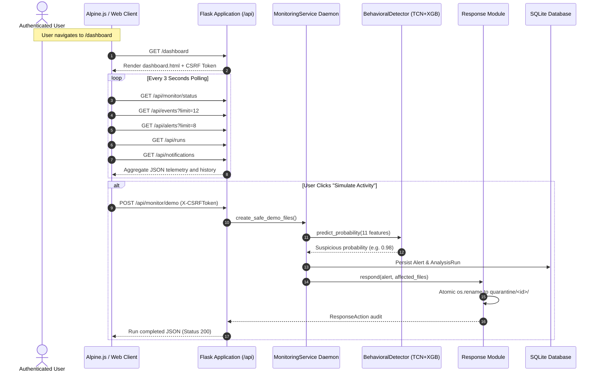
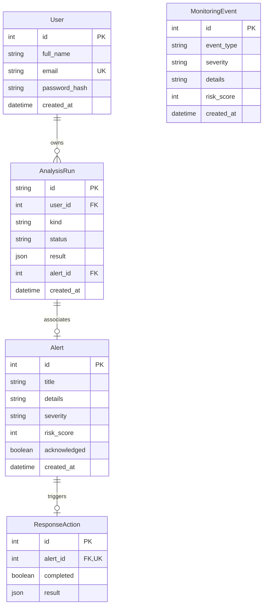

# RansomShield — Phase 1: Complete Project Discovery and Information Extraction Report

**Project Title:** RansomShield: A Behavioral Machine Learning Framework for Decoy-Server Ransomware Activity Monitoring and Alerting  
**Document Type:** Technical Discovery, Codebase Audit & System Architecture Report  
**Date of Audit:** October 17, 2026  
**Auditor Mode:** Read-Only Static & Dynamic Inspection  
**Base Repository Path:** `e:/final year project/ransoware/ransoware`  
**Test Suite Verification:** 36 / 36 Passing (`tests/test_features.py`, `tests/test_runs.py`, `tests/test_transfer.py`)  

---

## 1. Project Overview and Technology Stack

RansomShield is a research-grade prototype designed for behavioral monitoring, machine-learning-driven threat detection, and automated containment of ransomware activity. Unlike conventional signature-based antivirus solutions or risky production-level endpoint agents, RansomShield operates against an isolated decoy server directory (`instance/decoy_server/`), watching for behavioral signals across file system modifications, host resource telemetry, and canary asset interactions.

### 1.1 Core Principles & Architecture
1. **Safe Scope:** The application strictly bounds its active monitoring to `instance/decoy_server/`. It does not monitor arbitrary personal user files, scan user home directories, or terminate operating system processes.
2. **Behavioral Telemetry:** Every 2 seconds, a background monitoring daemon collects an 11-dimensional behavioral feature vector capturing file creations, modifications, deletions, CPU and memory utilization, process counts, canary interactions, and operation rates.
3. **Hybrid Machine Learning:** A Temporal Convolutional Network (TCN) models sequential changes over an 8-window sliding history to capture temporal trends, feeding a learned embedding alongside the current feature vector into an XGBoost classifier.
4. **Automated Response:** Detections exceeding calibrated risk thresholds trigger automatic containment (quarantining affected test files into `instance/quarantine/<alert_id>/`) and dispatch incident notifications via email (SMTP) and HTTPS webhooks.

### 1.2 Technology Stack & Dependency Inventory

| Layer | Component | Version | Purpose & Scope |
|---|---|---|---|
| **Runtime Language** | Python | 3.11.9 (active) / 3.9+ | Main runtime for backend services, ML inference, and automation scripts. |
| **Web Framework** | Flask | 3.1.1 | Application factory, blueprint routing, session handling, REST endpoints. |
| **Database & ORM** | Flask-SQLAlchemy / SQLAlchemy | 3.1.1 / 2.1.5 | ORM mapping for users, monitoring events, alerts, responses, and analysis runs. |
| **Authentication** | Flask-Login | 0.6.3 | Session management, login gating (`@login_required`), user context (`current_user`). |
| **Forms & CSRF** | Flask-WTF / WTForms | 1.2.2 / 3.2.2 | Cross-Site Request Forgery protection (`csrf.init_app`) and form validation. |
| **Email Validation** | email-validator | 2.2.0 | RFC-compliant email address validation during registration. |
| **System Telemetry** | psutil | 7.0.0 | Snapshot measurements for CPU percent, virtual memory percent, and process counts. |
| **Scientific & Array** | NumPy | 2.0.2 | Matrix operations, standardization, 1D causal convolutions, ReLU pooling. |
| **Machine Learning** | XGBoost | 2.1.4 | Tree-boosted binary classification (`xgboost.Booster`, `xgboost.train`). |
| **Environment Config**| python-dotenv | 1.0.1 | `.env` variable loader without interpolation. |
| **CSS Framework** | Bootstrap | 5.3.3 (CDN) | Responsive layout grid, utility classes, and base components. |
| **Utility CSS** | TailwindCSS | CDN (`preflight: false`) | Fine-grained utility styling supplementing custom CSS variables. |
| **Iconography** | Bootstrap Icons | 1.11.3 (CDN) | SVG iconography for status badges, metric cards, and navigation. |
| **Client Reactivity** | Alpine.js | 3.x.x (CDN) | Declarative UI state, periodic polling timers, fetch error handling. |

---

## 2. Complete Project Structure

```text
e:/final year project/
├── Ransomwareeeeeeeeeeee.pdf               # Background project reference document (5.4 MB)
└── ransoware/
    └── ransoware/
        ├── .env                            # Local environment configuration (SMTP, Webhook secrets)
        ├── .env.example                    # Template for environment configuration
        ├── .gitignore                      # Git exclusion rules
        ├── .venv/                          # Virtual environment (Python 3.11)
        ├── Laptop1_Sender.zip              # Standalone bundle for Laptop 1 (sender script, instructions, sample)
        ├── README.md                       # Comprehensive system documentation and operational workflow
        ├── ROADMAP.md                      # Milestone checklist and implementation status matrix
        ├── RansomShield_Current_Implementation.pptx # Project status presentation slides
        ├── TWO_LAPTOP_SETUP.md             # Windows OpenSSH SFTP two-laptop deployment guide
        ├── requirements.txt                # Production Python dependencies
        ├── requirements-presentation.txt   # python-pptx dependency for presentation generator
        ├── run.py                          # Application entry point (`create_app().run(debug=True)`)
        ├── app/                            # Core Flask application package
        │   ├── __init__.py                 # Application factory `create_app()`, config initialization
        │   ├── api.py                      # Protected REST API endpoints (`/api/*`)
        │   ├── auth.py                     # Authentication blueprint (`/auth/signin`, `/auth/signup`, `/auth/signout`)
        │   ├── detector.py                 # Sequential TCN + XGBoost hybrid inference engine
        │   ├── extensions.py               # Flask extension instances (`db`, `login_manager`, `csrf`)
        │   ├── forms.py                    # WTForms definitions (`SigninForm`, `SignupForm`)
        │   ├── mlran.py                    # Tabular MLRan XGBoost inference and schema validator
        │   ├── models.py                   # SQLAlchemy models (`User`, `MonitoringEvent`, `Alert`, `ResponseAction`, `AnalysisRun`)
        │   ├── monitor.py                  # Background telemetry polling service & decoy generator
        │   ├── response.py                 # File containment (quarantine), email SMTP, and webhook dispatch
        │   ├── routes.py                   # Frontend page blueprint (`/`, `/dashboard`)
        │   ├── runs.py                     # Execution engine for simulations and uploaded datasets
        │   ├── transfer.py                 # SFTP inbox watcher, SHA-256 verification, and receipt writer
        │   ├── artifacts/                  # Frozen model weights and schemas
        │   │   ├── behavioral_model.json   # TCN + XGBoost architecture metadata, means, scales, metrics
        │   │   ├── tcn_weights.npz         # Frozen causal 1D convolution weights (kernels: [8,3,11], bias: [8])
        │   │   ├── xgboost_model.json      # Trained XGBoost Booster for hybrid telemetry (286 KB)
        │   │   └── mlran/                  # Published MLRan tabular artifacts
        │   │       ├── model.json          # Feature schemas, selected indices, held-out metrics
        │   │       └── xgboost_model.json  # Trained XGBoost Booster for MLRan features (202 KB)
        │   └── templates/                  # Jinja2 HTML templates
        │       ├── base.html               # Master layout, dark/light theme engine, nav, footer
        │       ├── index.html              # Public landing page, project explanation, roadmap, team
        │       ├── dashboard.html          # Authenticated live monitoring, run history, control panels
        │       └── auth/
        │           ├── signin.html         # Sign in form
        │           └── signup.html         # Sign up form
        ├── data/                           # Data directory
        │   ├── README.md                   # Dataset provenance, license, and schema documentation
        │   ├── safe_demo.csv               # 16-window smoke-test fixture (8 benign, 8 suspicious)
        │   ├── safe_demo_evaluation.json   # Baseline evaluation output of safe_demo.csv
        │   ├── rande_w11_preview.csv       # Public preview of RanDe-W11 (rejected by design)
        │   ├── rande_feature_guide.md      # Analysis of RanDe-W11 feature semantics
        │   ├── rande_drive.html            # Reference Google Drive metadata
        │   ├── mlran_files.json            # Manifest of upstream MLRan repository
        │   ├── mlran_repository.json       # Metadata of upstream MLRan commit
        │   └── mlran/                      # Published MLRan experiment data
        │       ├── MLRan_X_train_RFE.csv   # Published RFE training matrix (3.8 MB)
        │       ├── MLRan_X_test_RFE.csv    # Published RFE test matrix (957 KB)
        │       ├── MLRan_labels.csv        # Ground truth labels for MLRan samples
        │       ├── mlran_dataset_metadata.csv # Sample metadata and descriptions
        │       ├── RFE_selected_feature_names_dic.json # Feature description mapping
        │       ├── heldout.csv             # Cleaned held-out benchmark CSV (324 samples)
        │       ├── training_report.json    # Exact metrics from train_mlran.py
        │       ├── type_train_sampleids.csv# Sample IDs for training set
        │       ├── type_test_sampleids.csv # Sample IDs for testing set
        │       └── README.md               # MLRan provenance, cleaning audit, limitations
        ├── instance/                       # Local runtime state (ignored in git)
        │   ├── ransomshield.db             # SQLite database storing users, events, alerts, runs
        │   ├── decoy_server/               # Monitored folder hierarchy (`Finance`, `HR`, `Backup`, `Documents`)
        │   ├── quarantine/                 # Isolated quarantined files organized by `alert_id`
        │   └── runs/                       # Per-run execution sandboxes and test placeholders
        ├── papers/
        │   └── RansomShield_IEEE_Paper.tex # Full IEEE conference research paper manuscript
        ├── scripts/
        │   ├── train_model.py              # Synthetic sequential training script for TCN + XGBoost
        │   ├── train_mlran.py              # MLRan tabular XGBoost training and held-out extraction
        │   ├── evaluate_external.py        # CLI validator and evaluator for ordered telemetry CSVs
        │   ├── prepare_demo_csv.py         # Generator for `safe_demo.csv`
        │   ├── send_dataset.py             # Laptop 1 SFTP client transfer script
        │   ├── receive_dataset.py          # Laptop 2 SFTP inbox daemon watcher
        │   └── generate_project_ppt.py     # Automation script generating PowerPoint slides
        └── tests/
            ├── test_features.py            # Unit tests for response, quarantine, detector, telemetry
            ├── test_runs.py                # Unit tests for runs, simulations, ownership, and CSV reports
            └── test_transfer.py            # Unit tests for SFTP inbox, SHA-256 validation, receipts
```

---

## 3. Module-by-Module Implementation Details

### 3.1 Application Core (`app/`)

- **`__init__.py` (`create_app`)**: Initializes Flask in application factory mode. Sets up configuration keys (`RUNS_PATH`, `QUARANTINE_PATH`, `AUTO_QUARANTINE`, `SMTP_*`, `RESPONSE_*`). Ensures directories exist, registers extensions (`db`, `login_manager`, `csrf`), boots `MonitoringService`, registers blueprints (`main`, `auth`, `api`), and creates all database tables inside the app context.
- **`models.py`**: Defines 5 SQLAlchemy models:
  - `User`: User accounts with `full_name`, `email` (unique index), `password_hash`, `created_at`. Employs `generate_password_hash` and `check_password_hash`.
  - `MonitoringEvent`: Telemetry events with `event_type`, `severity`, `details`, `risk_score`, `created_at`.
  - `Alert`: Threat alerts triggered by elevated risk scores, storing `title`, `details`, `severity`, `risk_score`, `acknowledged`, `created_at`, and linking to `ResponseAction`.
  - `ResponseAction`: Containment audit record referencing `alert_id`, storing `completed` boolean and `result` JSON (quarantined files, notification states).
  - `AnalysisRun`: User-owned test runs with `id` (UUID), `user_id`, `kind` (`simulation`, `dataset`, `laptop_transfer`), `status`, `result` JSON, and optional `alert_id`.
- **`forms.py`**: Implements `SignupForm` (full name, email, password, confirm password) and `SigninForm` (email, password, remember me) with WTForms validators.
- **`auth.py`**: Handles user registration, credential authentication, session binding via Flask-Login, and safe redirection preventing open-redirect vulnerabilities (`is_safe_redirect_target`).
- **`routes.py`**: Serves top-level public pages (`/` for `index.html`) and protected pages (`/dashboard` for `dashboard.html`).
- **`api.py`**: Central REST API managing monitoring lifecycle (`/api/monitor/start`, `/api/monitor/stop`, `/api/monitor/status`), running simulations (`/api/monitor/demo`), file uploads (`/api/runs/dataset`), pre-bundled dataset runs (`/api/runs/mlran`, `/api/runs/local-transfer`), user run history (`/api/runs`), alert acknowledgement (`/api/alerts/<id>/acknowledge`), and CSV audit exports (`/api/runs/<id>/report.csv`, `/api/alerts/<id>/report.csv`). Includes formula-injection escaping for all generated CSV rows.
- **`monitor.py`**: Contains `MonitoringService`. Runs a background daemon thread polling every 2 seconds. Calculates differential file snapshots (created, modified, deleted) in `instance/decoy_server/`, reads system metrics with `psutil`, computes an 11-feature telemetry vector, queries `BehavioralDetector`, and logs events/alerts.
- **`detector.py`**: Implements `BehavioralDetector`. Standardizes the 11 features using frozen mean/scale parameters, maintains an 8-window history, computes causal 1D dilated convolutions with ReLU activation and temporal mean pooling, concatenates the resulting 8 temporal features with the current 11 features into a 19-dimensional vector, and queries an XGBoost Booster.
- **`mlran.py`**: Specialized tabular evaluator for published MLRan datasets. Enforces strict schema validation (checks binary 0/1 values, unique sample IDs, absence of label leakage), loads the separate tabular XGBoost model (`app/artifacts/mlran/`), and generates per-sample predictions.
- **`response.py`**: Implements audited protective response. Performs rigorous validation on affected file paths (verifies path remains inside monitored root, excludes symlinks and Windows reparse points, ensures regular files). Moves files via atomic `os.rename` to `instance/quarantine/<alert_id>/`. Dispatches alert payloads over HTTPS webhooks and SMTP email (STARTTLS on port 587 or SSL on port 465).
- **`runs.py`**: Handles execution of on-demand simulations and uploaded dataset evaluations. Creates isolated sandboxes under `instance/runs/<run_id>/`, saves test files, runs model evaluation, and initiates containment if predictions exceed the decision threshold.
- **`transfer.py`**: Implements the receiving side of the two-laptop transfer architecture. Watches an inbox directory for `.ready.json` manifests, verifies file sizes and SHA-256 hashes, prevents replay attacks, binds the run to a specified user account, executes detection, and atomically writes out `.result.json` receipts.

### 3.2 Automation Scripts (`scripts/`)

- **`train_model.py`**: Deterministic synthetic training generator. Creates 6,000 synthetic sequences (4,800 train / 1,200 test) across benign and escalating ransomware patterns with 3.5% label noise. Trains the TCN convolutional filter kernels using backpropagation and fits the XGBoost Booster. Outputs `behavioral_model.json`, `tcn_weights.npz`, and `xgboost_model.json`.
- **`train_mlran.py`**: Trains the tabular XGBoost model on published MLRan records. Cleans duplicate and ambiguous feature vectors, separates training and test splits with zero vector overlap, excludes metadata/signatures to prevent data leakage, and outputs `model.json` and `xgboost_model.json` under `app/artifacts/mlran/`.
- **`evaluate_external.py`**: CLI tool for evaluating arbitrary ordered telemetry CSVs against the frozen TCN + XGBoost detector. Enforces strict column validation, consecutiveness of window indices, and generates JSON audit reports.
- **`prepare_demo_csv.py`**: Generates `data/safe_demo.csv` with 16 synthetic windows (8 benign, 8 suspicious) across two distinct traces.
- **`send_dataset.py`**: Standalone client script for Laptop 1. Uses Python's standard library and the OpenSSH `sftp` binary to upload a dataset and SHA-256 manifest to Laptop 2, polling for completion receipts.
- **`receive_dataset.py`**: Daemon process for Laptop 2. Watches the SFTP inbox, executes `transfer.receive_one()`, and writes atomic completion receipts.
- **`generate_project_ppt.py`**: Automation script using `python-pptx` to generate the project overview PowerPoint presentation (`RansomShield_Current_Implementation.pptx`).

---

## 4. Existing Feature Inventory & Implementation Status

| Feature / Capability | Implementation Status | Functional Analysis & Evidence |
|---|---|---|
| **User Sign-up & Sign-in** | **Fully Implemented** | Passwords hashed using PBKDF2/scrypt salts; unique email enforcement; session management via Flask-Login. Tested in [`tests/test_runs.py`](file:///e:/final%20year%20project/ransoware/ransoware/tests/test_runs.py). |
| **Decoy Server Honeypot** | **Fully Implemented** | Automatically seeds dummy corporate directories (`Finance`, `HR`, `Backup`, `Documents`) in `instance/decoy_server/`. |
| **Canary File Traps** | **Fully Implemented** | 3 specific canaries (`Salary_Data.xlsx`, `Employee_Data.xlsx`, `database_backup.sql`). Modifications or deletions trigger binary alert flags $x_7, x_8$. |
| **Real-Time Telemetry Polling** | **Fully Implemented** | Daemon thread polls every 2 seconds, calculating differential file snapshots and querying `psutil` for host metrics. |
| **Sequential TCN + XGBoost Model** | **Fully Implemented** | Standardized inputs over an 8-window history; 1D causal convolution with dilation $d=2$; feature fusion into XGBoost Booster at threshold 0.60. |
| **Deterministic Fallback Heuristic**| **Fully Implemented** | Audited rule-based scoring ($7 \cdot \Delta f + 8 \cdot \text{del} + 35 \cdot \text{canary}$) active if ML models are missing or unreadable. |
| **Safe Burst Simulation** | **Fully Implemented** | Generates 24 `.locked-demo` test files and modifies canaries in an isolated folder, executing full inference and containment. |
| **Automated Containment (Quarantine)**| **Fully Implemented** | Moves affected test files to `instance/quarantine/<alert_id>/` via atomic `os.rename`. Validates against path traversal and symlinks. |
| **Configurable Email Notifications**| **Fully Implemented** | Dispatches JSON alert summaries via SMTP (STARTTLS/SSL) based on `.env`. Tested via mocks in [`tests/test_features.py`](file:///e:/final%20year%20project/ransoware/ransoware/tests/test_features.py). |
| **Webhook Notifications** | **Fully Implemented** | Sends POST requests to `RESPONSE_WEBHOOK_URL` with alert details and quarantined file lists. |
| **CSV Telemetry Upload & Evaluation**| **Fully Implemented** | Accepts external CSV files up to 5 MB, validates schemas, and processes up to 2,000 windows per trace. |
| **Published MLRan Evaluation** | **Fully Implemented** | Evaluates 58 binary behavioral features on published MLRan samples using an independent tabular XGBoost pipeline. |
| **Incident Reports & CSV Export** | **Fully Implemented** | Downloads audit reports with formula injection escaping (prefixes `=`, `+`, `-`, `@` with `'`). |
| **Two-Laptop Transfer Pipeline** | **Implemented Locally** | SFTP sender/receiver with SHA-256 manifests. Fully verified via unit tests and local mocks; physical multi-laptop test pending. |
| **Malware Execution / Process Termination**| **Excluded by Design** | RansomShield does not terminate OS processes or execute real malware. It is designed as a safe, bounded behavioral demonstration tool. |
| **PDF Report Export** | **Unimplemented / Skipped** | Explicitly scoped to CSV format in [`ROADMAP.md`](file:///e:/final%20year%20project/ransoware/ransoware/ROADMAP.md). PDF generation is not implemented. |

---

## 5. Frontend and Backend Architecture

### 5.1 Request and Response Flow



### 5.2 Database Structure & Data Relationships



---

## 6. Machine Learning and Dataset Analysis

### 6.1 Datasets Inventory

| Dataset | Location | Records | Dimensions | Labels & Schema | Purpose & Role |
|---|---|---|---|---|---|
| **Safe Demo Fixture** | `data/safe_demo.csv` | 16 windows (2 traces) | 14 columns | Binary (8 benign, 8 suspicious) | Smoke-testing pipeline, dashboard upload, and SFTP transfer. |
| **Synthetic Sequential Dataset** | Generated via `scripts/train_model.py` (seed `20261014`) | 6,000 sequences | 8 steps $\times$ 11 features | Binary (42% suspicious with progressive ramp and 3.5% noise) | Trains the frozen TCN kernels and XGBoost hybrid booster. |
| **RanDe-W11 Preview** | `data/rande_w11_preview.csv` | 50 rows | 27 static aggregate columns | Binary (benign / ransomware) | **Rejected by design:** lacks temporal sequence and canary indicators. |
| **Published MLRan Dataset** | `data/mlran/` | 4,880 samples (3,905 train / 975 test) | 58 filtered behavioral binary indicators | Binary (0: benign, 1: ransomware) | Real published benchmark evaluated via tabular XGBoost. |
| **MLRan Cleaned Held-Out Set** | `data/mlran/heldout.csv` | 324 samples | 58 binary features + `sample_id` + `sample_type` | Binary (95 ransomware, 229 benign) | Zero vector overlap with training split; verified benchmark. |

### 6.2 The 11 Sequential Behavioral Features

| Index | Feature Symbol | Code Name | Range | Physical Meaning | Normalization ($\mu \pm \sigma$) |
|---|---|---|---|---|---|
| 1 | $x_1$ | `created_count` | $\mathbb{N}_0$ | New files created in decoy folder during 2s window | $4.36 \pm 5.36$ |
| 2 | $x_2$ | `modified_count` | $\mathbb{N}_0$ | Existing files modified during 2s window | $7.09 \pm 8.64$ |
| 3 | $x_3$ | `deleted_count` | $\mathbb{N}_0$ | Files deleted during 2s window | $2.08 \pm 3.55$ |
| 4 | $x_4$ | `cpu_percent` | $[0, 100]$ | Host CPU utilization percentage | $42.25 \pm 26.24$ |
| 5 | $x_5$ | `memory_percent` | $[0, 100]$ | Host RAM utilization percentage | $58.02 \pm 15.52$ |
| 6 | $x_6$ | `process_count` | $\mathbb{N}_0$ | Number of running operating system processes | $135.72 \pm 42.10$ |
| 7 | $x_7$ | `canary_accessed` | $\{0, 1\}$ | Indicates whether any of the 3 canary files were touched | $0.14 \pm 0.35$ |
| 8 | $x_8$ | `canary_modified` | $\{0, 1\}$ | Indicates whether any canary file was altered | $0.10 \pm 0.30$ |
| 9 | $x_9$ | `decoy_files_touched` | $\mathbb{N}_0$ | Total count of affected files in the decoy server ($x_1 + x_2 + x_3$) | $13.53 \pm 16.41$ |
| 10 | $x_{10}$ | `directories_touched` | $\mathbb{N}_0$ | Distinct root subfolders touched (`Finance`, `HR`, etc.) | $1.09 \pm 1.32$ |
| 11 | $x_{11}$ | `operation_rate` | $\mathbb{R}_{\ge 0}$ | File operations per second ($x_9 / \Delta t$) | $6.77 \pm 8.21$ |

### 6.3 Model Architecture & Mathematical Formulation

1. **Standardization:** For each feature vector $x \in \mathbb{R}^{11}$:
   $$z_j = \frac{x_j - \mu_j}{\sigma_j}, \quad j \in \{1, \dots, 11\}$$
2. **Causal Temporal Convolution:** Over sliding sequence length $T=8$, with kernel size $K=3$ and dilation $d=2$:
   $$\text{window}(k) = z_{t - k \cdot d}, \quad k \in \{0, 1, 2\}$$
   $$\text{emb}_f = \frac{1}{T} \sum_{t=1}^{T} \max\left(0, \sum_{k=0}^{2} \sum_{c=1}^{11} W_{f,k,c} \cdot z_{t - 2k, c} + b_f\right), \quad f \in \{1, \dots, 8\}$$
3. **Feature Fusion:** The latest normalized feature row $z_t$ is concatenated with the 8 temporal embeddings:
   $$v = [z_t \,\|\, \text{emb}] \in \mathbb{R}^{19}$$
4. **XGBoost Inference:** Vector $v$ is classified by the trained booster (`xgboost_model.json`, 160 trees, max depth 4):
   $$\hat{y} = \sigma(\text{XGBoost}(v)) \in [0, 1]$$
   If $\hat{y} \ge 0.60$, the window is classified as suspicious.

### 6.4 Verified Model Evaluation Results

| Model | Test Dataset | Evaluation Size | Accuracy | Precision | Recall | F1 Score | False Positive Rate |
|---|---|---|---|---|---|---|---|
| **TCN + XGBoost Hybrid** | Synthetic Held-Out Test Split | 1,200 sequences | **96.50%** | **96.99%** | **94.71%** | **95.83%** | **2.17%** |
| **XGBoost Only (Ablation)** | Synthetic Held-Out Test Split | 1,200 sequences | 96.42% | 96.98% | 94.51% | 95.73% | 2.17% |
| **MLRan Tabular XGBoost** | Published Cleaned Held-Out | 324 samples | **92.90%** | **85.29%** | **91.58%** | **88.32%** | **6.55%** |

---

## 7. System Monitoring and Response Workflows

### 7.1 Telemetry Collection & Honeypot Monitoring
- The monitoring daemon (`app/monitor.py`) polls every 2 seconds (`MONITOR_INTERVAL_SECONDS = 2.0`).
- Differential snapshot comparison:
  $$\text{created} = S_{\text{now}} \setminus S_{\text{prev}}, \quad \text{deleted} = S_{\text{prev}} \setminus S_{\text{now}}$$
  $$\text{modified} = \{ p \in S_{\text{now}} \cap S_{\text{prev}} \mid \text{mtime}_{\text{now}}(p) \ne \text{mtime}_{\text{prev}}(p) \lor \text{size}_{\text{now}}(p) \ne \text{size}_{\text{prev}}(p) \}$$
- Resource consumption: Queries `psutil.cpu_percent(interval=None)` and `psutil.virtual_memory().percent`.

### 7.2 Threat Classification & Threshold Policies
- **Monitoring Event:** Recorded whenever $\Delta f = |\text{created}| + |\text{modified}| + |\text{deleted}| > 0$.
- **Alert Trigger:** Risk score $\ge 60$ ($P \ge 0.60$).
  - **Medium Severity:** $60 \le \text{Risk} < 85$. (Triggers alert and notification audit; live monitoring does not quarantine).
  - **High Severity:** $\text{Risk} \ge 85$. (Triggers alert, notification audit, and automatic quarantine of affected files in the decoy).
- **Explicit Simulations / CSV Runs:** Quarantine of generated test placeholders occurs at the model decision threshold ($P \ge 0.60$), unless `AUTO_QUARANTINE=false`.

### 7.3 Protective Actions & Quarantine Pipeline
1. Validates that quarantine path (`instance/quarantine`) is strictly outside the monitored root.
2. For each affected file, checks that the path does not escape root (blocks `..`), is a regular file (not directory), and is not a symbolic link or Windows reparse point (checks `st_file_attributes & 0x400`).
3. Uses `os.rename(source, target)` for atomic same-filesystem movement.
4. If a file was already deleted by simulated activity, it is safely recorded as `failed` without interrupting other quarantine operations.

---

## 8. Security and Reliability Assessment

### Positive Security Engineering Controls
1. **Formula Injection Sanitization:** In [`app/api.py:L177`](file:///e:/final%20year%20project/ransoware/ransoware/app/api.py#L177), all exported CSV cells beginning with `=, +, -, @` are automatically prefixed with a single quote (`'`), preventing formula injection in spreadsheet viewers.
2. **Path Traversal & Symlink Protection:** Rigorous checks in [`app/response.py:L37-L48`](file:///e:/final%20year%20project/ransoware/ransoware/app/response.py#L37-L48) and [`app/transfer.py:L22-L34`](file:///e:/final%20year%20project/ransoware/ransoware/app/transfer.py#L22-L34) verify canonical paths, `os.fstat` file descriptors against races, and block symbolic links / reparse points.
3. **No Credential Leakage:** API endpoint `/api/notifications` inspects configuration completeness and returns status (`configured`/`incomplete`/`disabled`) without returning passwords or webhook URLs.
4. **CSRF Protection:** Flask-WTF CSRF tokens are injected into the HTML `<meta name="csrf-token">` and transmitted via `X-CSRFToken` in all Alpine.js `fetch` mutations.

### Technical Limitations & Risks

1. **Development Server in Execution:**
   - [`run.py`](file:///e:/final%20year%20project/ransoware/ransoware/run.py) runs Flask in debug mode (`app.run(debug=True)`), which is suitable for demonstration but unsuitable for production.
2. **Synchronous File Upload Processing:**
   - In [`app/api.py:L140`](file:///e:/final%20year%20project/ransoware/ransoware/app/api.py#L140), CSV analysis runs synchronously in the HTTP request thread. Although capped at 2,000 rows, evaluating large batches may cause noticeable HTTP request latency.
3. **In-Memory History Reset:**
   - The sliding 8-window history is held in an in-memory `deque` in [`app/detector.py`](file:///e:/final%20year%20project/ransoware/ransoware/app/detector.py#L13). If the monitor restarts, temporal history resets to zero and uses repeated-padding for the first 7 cycles.
4. **Physical SFTP Transfer Unvalidated on Dual Hardware:**
   - The two-laptop transfer scripts ([`scripts/send_dataset.py`](file:///e:/final%20year%20project/ransoware/ransoware/scripts/send_dataset.py) and [`scripts/receive_dataset.py`](file:///e:/final%20year%20project/ransoware/ransoware/scripts/receive_dataset.py)) function cleanly with unit tests and local mocks, but have not been executed between two physical machines on a shared Wi-Fi network.

---

## 9. Information Gaps & Items Requiring Physical Verification

1. **Physical Two-Laptop SFTP Connection:**
   - Verification of the OpenSSH server connection, trusted host key fingerprint, and firewall traversal over Wi-Fi between Laptop 1 and Laptop 2.
2. **Live SMTP Server Credentials:**
   - Live end-to-end email delivery test requiring real host credentials in `.env` (automated tests used mock mail servers).
3. **Full RanDe-W11 Dataset Access:**
   - Upstream authors provide only a static sample preview; full time-series traces require special author access.

---

*End of Phase 1 Technical Audit Report.*
